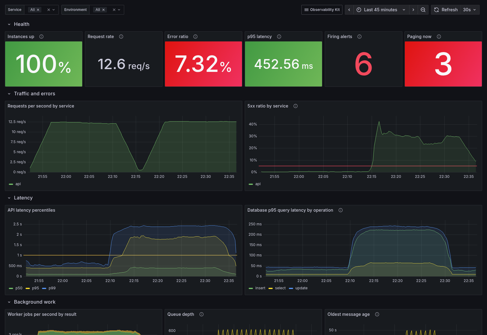
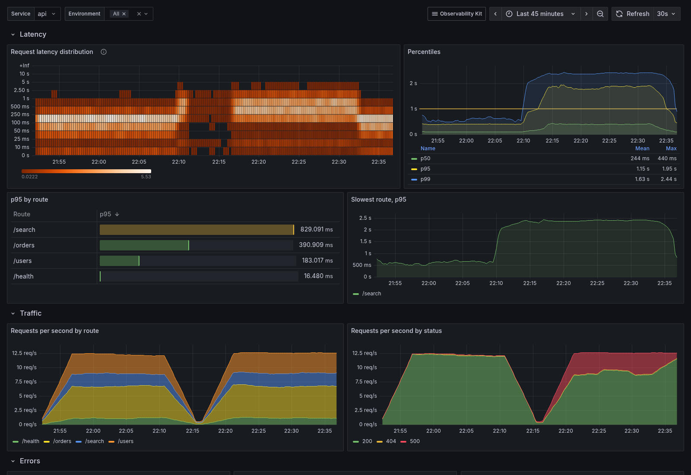
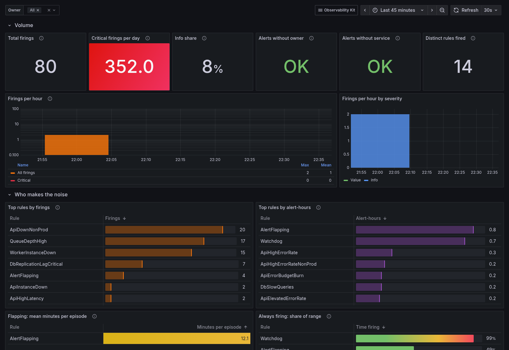
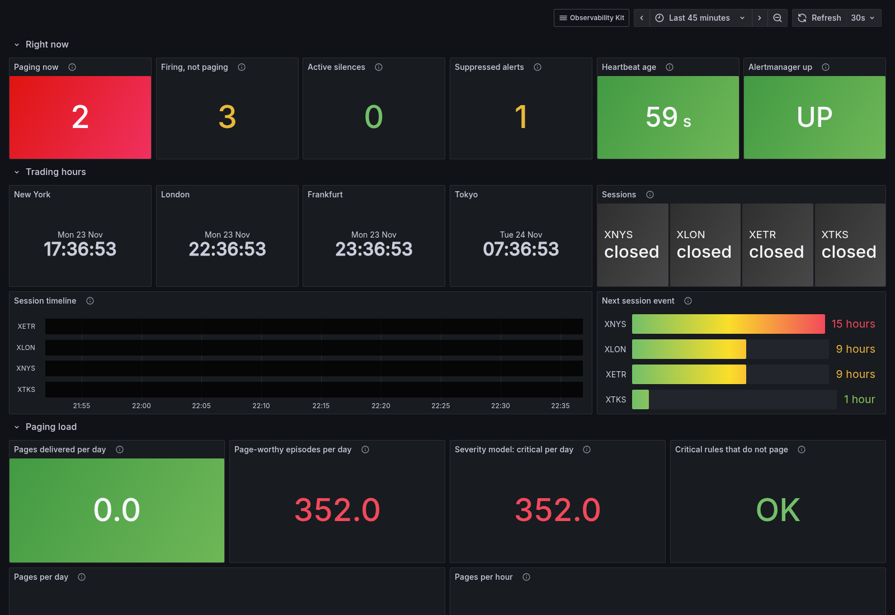

# grafana-observability-kit

A self-contained observability stack that shows how I approach dashboards and
alerting: Prometheus, Alertmanager, Grafana, a simulated application fleet, four
provisioned dashboards, 34 alert rules on one template, and the meta-alerting that
keeps the rules themselves honest.

Everything runs locally with one command. No real data, no real hosts, no real
company: the fleet is a Python generator that produces realistic load, errors,
latency and outages.

## The problem it addresses

Most alerting setups fail the same way. Rules accumulate, severity labels stop
meaning anything, half the rules flap and the other half never resolve, and the
on-call engineer learns to ignore the pager. By the time someone measures the
noise, the measurement itself is wrong, because `count_over_time(ALERTS[30d])`
counts samples, not alerts.

This kit is the toolset I use to make that visible and to work it down:

- **Measure the right thing.** Episodes, not samples. Alert-hours, not row counts.
- **Separate the four kinds of noise** (fires too often, stays on too long,
  flaps, never changes) because each has a different fix.
- **Make severity mean a reaction**, with a routing layer that enforces it and
  meta-rules that report every mismatch as a cleanup backlog.
- **Verify delivery, not just evaluation.** What Alertmanager sent, and where, is
  on the dashboard.
- **Put the pager in context.** For trading-floor support, an outage during an
  open session is a different incident from the same outage at 03:00.

## What is inside

```
docker-compose.yml           Prometheus 3.5, Alertmanager 0.28, Grafana 12, node-exporter,
                             metrics-generator, optional image renderer
metrics-generator/           Python fleet: api, worker, db, queue; scenario engine;
                             market-session metrics; Alertmanager webhook sink
prometheus/rules/            34 rules in 5 groups, one template (owner, severity, page, runbook)
alertmanager/                routing by severity + page, inhibition, 4 receivers
grafana/provisioning/        datasource + 4 dashboards, provisioned from files
tools/build_dashboards.py    dashboards as code: regenerates the JSON
tools/check_leaks.sh         guards the public tree against private reference material
tools/screenshots.sh         renders every dashboard to docs/screenshots/
docs/ALERT_RULE_TEMPLATE.md  the rule template and the rules of thumb
docs/DESIGN_NOTES.md         why things are built this way
docs/runbooks/               one runbook per alert family
```

## Run it

```bash
git clone <this repo> && cd grafana-observability-kit
make up            # or: docker compose up -d --build
```

| Service      | URL                           | Notes                                  |
|--------------|-------------------------------|----------------------------------------|
| Grafana      | http://localhost:3000         | admin / admin; anonymous viewer enabled |
| Prometheus   | http://localhost:9090         | rules, alerts, targets                  |
| Alertmanager | http://localhost:9093         | silences, routing status                |
| Generator    | http://localhost:8000/metrics | raw metrics                             |

The dashboards are in the **Observability Kit** folder. The alert-noise and
on-call dashboards need history: give the stack an hour, or start it with
`make demo` (`SCENARIO_SPEED=4`) to get incidents four times as often.

Other targets: `make check` (validate rules, config, JSON, run the leak check),
`make dashboards` (regenerate JSON), `make screenshots`, `make clean`.

## Dashboards

The images below are produced by `make screenshots` (see below) and are not
committed until the stack has run long enough to show real history.

### Service Overview — `svc-overview`



One page for the fleet: instances up, request rate, error ratio, p95 latency,
and what is firing, then traffic, errors, latency, background work and storage
by service. Alert thresholds are drawn on the panels as lines, so "is this bad"
has an answer on the chart.

### Golden Signals — `golden-signals`



Latency, traffic, errors and saturation for one service. The latency heatmap
shows a slow dependency as a second band rather than a shift. The error section
includes a multi-window burn rate against a 99.5% SLO, which is the page that
matters even when the raw error ratio looks small.

### Alert Noise Overview — `alert-noise`



Which rules make the noise, how much, and what kind. Firings and alert-hours are
separate tables because they find different problems. Flapping and always-firing
tables point at rules that need a longer `for:` or should not be alerts at all.
Cardinality shows where Alertmanager grouping, not the rule, is the fix.
Label-hygiene panels list every rule without an owner or a service.

### On-call View — `on-call-view`



What is paging now, silences and suppressed alerts, the heartbeat age, and four
exchange clocks with a session timeline. Then paging load three ways: pages the
pager actually received, page-worthy episodes, and what the pager *would* receive
if routing followed severity alone. The gap between the last two is the severity
cleanup backlog, listed as a table underneath.

## Alert rules

Every rule carries the same labels and annotations:

```yaml
labels:
  owner: web            # team that fixes it
  severity: critical    # critical | warning | info
  page: "true"          # interrupt a human, or not
annotations:
  summary: "API has no healthy instance in production"
  description: "What the number means and the first thing to check."
  runbook_url: https://example.org/runbooks/api-down
```

`critical` pages, `warning` goes to the team's chat, `info` goes to a report. The
pager route additionally requires `environment="production"`. Five meta-rules
read the `ALERTS` series and the delivery counters, and report labelling
mistakes, flapping and an exceeded paging budget as alerts of their own. Two rules are deliberately imperfect
(`QueueDepthHigh` flaps; `DeprecatedRuntimeInUse` never resolves) so the noise
dashboard has something to catch.

The template and the rules of thumb are in
[docs/ALERT_RULE_TEMPLATE.md](docs/ALERT_RULE_TEMPLATE.md). Thresholds are
plausible, not tuned: there is no production behind them.

## Design notes

The short version; the long version is [docs/DESIGN_NOTES.md](docs/DESIGN_NOTES.md).

**Severity is a reaction.** Three values, each tied to exactly one delivery path.
Extra tiers create boundary disputes and values that route nowhere.

**`page` is separate from `severity`.** It is the decision to interrupt a person.
Keeping it apart allows non-production `critical` conditions that never page, and
makes a migration between routing conventions measurable: the On-call View shows
pages under the current routing next to pages under a severity-only model.

**Episodes, not samples.** `changes(ALERTS_FOR_STATE[range])`, plus one for each
series that first appeared inside the range. The second term is the part people
miss; without it rules with per-instance labels are undercounted by about half.

**Alert-hours as the second unit.** Sample count divided by samples per hour.
"Fires often" and "stays on" are different diseases; the two top-N tables rarely
overlap.

**Count events for crash loops.** `app_up == 0 for 5m` never fires on a process
that is back in 20 seconds. `WorkerCrashLooping` counts restarts instead.

**Group by what a human would fix.** `group_by: [alertname, service, environment]`,
so a second service with the same symptom is not merged into the first one's
notification.

**Verify delivery.** The webhook sink counts what each receiver got. A `page="true"`
alert missing from the pager receiver is a routing bug on a dashboard, not a
surprise during an outage.

**The heartbeat is the only alert that matters when it is quiet.** `Watchdog`
fires forever; its absence is the signal. The kit runs a single Alertmanager on
purpose and shows the heartbeat age as the compensating control.

## Screenshots

```bash
make up            # or make demo
# wait an hour, or longer for the 24h panels
make screenshots   # starts the grafana-image-renderer profile and renders docs/screenshots/*.png
```

Without Docker's renderer: open each dashboard in a browser with `&kiosk` appended
to the URL and take a window screenshot at 1600 px width.

## Related

[us-market-widget](https://github.com/NadezhdaLeo/us-market-widget) — the desktop
indicator this kit's trading-hours row is a simplified version of. The widget derives
the full NYSE holiday and early-close calendar from the exchange rules; the kit's
`market_session_open` metric uses weekday hours only.

## Private reference material

Dashboards and rules in this repository were built from scratch. The structure
and some of the ideas come from production dashboards I built elsewhere, which
live in `_private/` on my machine only. That folder is in `.gitignore`, and
`tools/check_leaks.sh` derives a token list from it (hostnames, UIDs, label
values, identifiers) and fails if any of them appear in the public tree. `make
check` runs it.

## Limitations

- The fleet is simulated. Latency distributions, error patterns and incident
  timing are plausible, not measured.
- Market sessions use weekday hours only; there is no holiday calendar.
- Prometheus retention is 7 days; the 24-hour panels fill up after a day.
- The heartbeat check runs inside the monitored stack. In production it must not.

## License

MIT. See [LICENSE](LICENSE).
